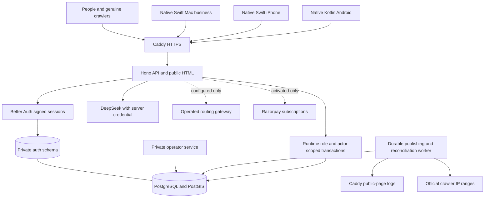
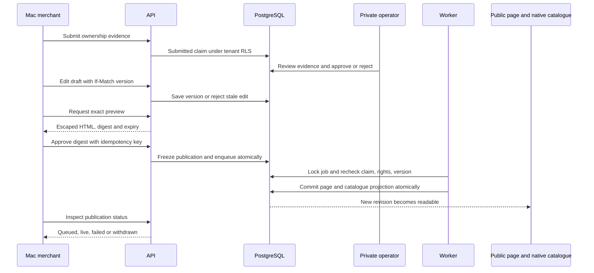
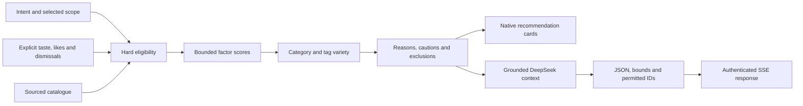

# Implemented VPS architecture

**The expanded current system is documented in [Unified architecture](../../docs/UNIFIED-ARCHITECTURE.md).** The diagrams below retain the original server slice for context.

This supersedes the earlier Swift/Vapor and Vercel/Neon deployment proposals. The server is a modular TypeScript application with PostgreSQL/PostGIS and a separate worker; the mobile and desktop products remain native. Every box below corresponds to code in this repository.

The database has four credentials: bootstrap/migration, auth-only, API runtime without RLS bypass, and private worker/operator. The API cannot approve claims by changing a tenant row. The public reverse proxy blocks all operator/internal routes and overwrites the client-IP header. A worker failure leaves work recoverable in PostgreSQL.

## Exact publication

Ownership, consent to publish, individual fact accuracy and independent entrance verification are different states. Public merchant profiles are owner supplied; publication does not manufacture independent fact verification. Static basic data remains distinct from missing current hours or crowd information.

## Recommendations and AI

No paid ranking factor, inferred sensitive identity, invented footfall or stored precise route origin. Unknown real-time constraints are explained. Strict requests requiring unavailable verified facts return no asserted matches. The 23 scenarios are evaluation fixtures, not fine-tuning data and not a human relevance study.

## Durable operations

- Commands use tenant authorization, transactional audit rows, actor-scoped idempotency and optimistic draft/profile revisions.
- Publication and billing inboxes survive process restarts; jobs use database locking and bounded retry. Publication is atomic across public HTML and native catalogue facts.
- Crawler observations deduplicate infrastructure request IDs, verify IP ranges separately from User-Agent claims, exclude HEAD/synthetic requests and separate status200 from304. Capture is reported as partial; there is no made-up million-crawl number.
- Database and HTTPS volumes survive container replacement. Backup and isolated restore scripts are included. The supplied CI template exercises the Linux container stack, migrations, tests and recovery after an authorized operator installs it; execution status is recorded in verification.
- APIs are versioned under `/v1`; catalogues have ETags and stable slug IDs. Personal sync is explicit and conflict preserving.

## Deliberate launch gates

No VPS IP or domain has been supplied, so this delivery is a runnable package, not an assertion of a public production launch. Razorpay, SMTP, routing/live traffic and external event/media agreements require actual accounts or operations. India-wide field coverage, professional entrance surveys, measured relevance studies, automated multi-stop route optimization, multi-region failover, third-party listing connectors and citation measurement are not implemented by declaring them in a diagram.

See [setup](../README.md), [consumer API](Consumer-API.md), [merchant API](Merchant-API.md), and [verification](Verification.md).
